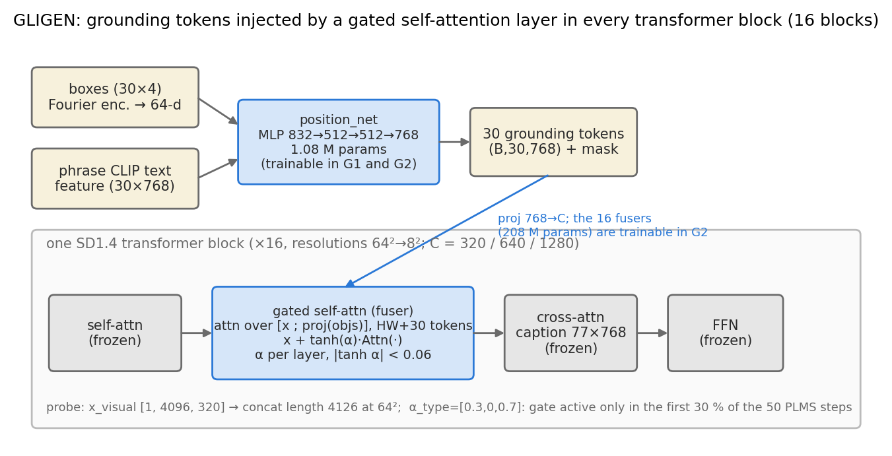
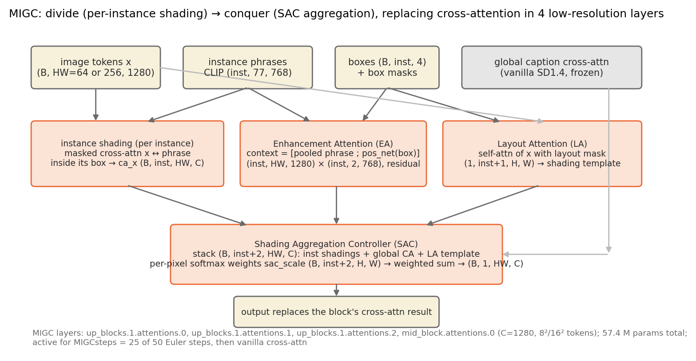

# 架构分析：GLIGEN 的布局注入 vs. MIGC 的实例控制（EA / LA / SAC）

本文区分三类陈述：**[实现事实]** 来自官方代码和我们的前向探测（`outputs/analysis/gligen_probe.json`、`migc_probe.json`，
同一布局 mig277_s42，512×512，第一步去噪）；**[观察]** 来自我们的评测结果；**[假设]** 是把两者联系起来的解释，尚未单独验证。
结构图：`outputs/final_analysis/figures/arch_gligen.png`、`arch_migc.png`（`analysis/draw_architecture.py` 生成）。

## 1. 两种方法在 UNet 里"接"在哪里

**GLIGEN** [实现事实]
- 基座 SD1.4 的 16 个 transformer block（分辨率 64²、32²、16²、8²，通道 320/640/1280）**每个**都插入一层 *gated self-attention*（代码里叫 fuser），
  位置在原自注意力之后、文本交叉注意力之前。
- 输入 grounding token 由 `position_net` 产生：框坐标 Fourier 编码（64 维）+ 该短语的 CLIP 文本特征（768 维）→ MLP 832→512→512→768；固定 30 个槽位，
  空槽用可学习的 null 特征填充。参数 1.08 M。
- fuser 把 HW 个视觉 token 与 30 个（投影到 C 维的）grounding token 拼接做自注意力（64² 层拼接长度 4126），只取视觉部分，
  残差写回：`x + tanh(α)·Attn([x; objs])`。α 是每层一个标量，官方权重 |tanh α| 全部 < 0.06。16 个 fuser 共 208 M 参数（UNet 总量 1 069 M 的 19.5%）。
- 推理时 `alpha_type=[0.3, 0, 0.7]`：**只在前 30% 的采样步（15/50）**打开 fuser，后 70% 的步数等同于普通 SD1.4。与 MIGC 的 25/50 步不同——这是除采样器外另一项未统一的生成设置。
- 颜色等属性**没有专门通道**：短语"a red carrot"整体经 CLIP 编码进 grounding token；全图 caption 也含所有颜色词，由冻结的交叉注意力处理。

**MIGC** [实现事实]
- 只替换 **4 个低分辨率层**的交叉注意力处理器：`mid_block.attentions.0`（8² = 64 token）和 `up_blocks.1.attentions.{0,1,2}`（16² = 256 token），
  均为 C = 1280。4 层共 57.4 M 参数（diffusers UNet 860 M 的 6.7%）。其余 12 个交叉注意力层保持原样。
- 对每个实例**分别**做一次 masked cross-attention（图像 token ↔ 该实例的短语 token，注意力限制在其框内），得到 `ca_x (B, 1+inst, HW, C)`
  —— "1+" 是全图 caption 的普通交叉注意力结果。
- **Enhancement Attention (EA)**：对每个实例，用 2 个 token 的上下文（池化后的短语特征 + `pos_net(box)` 产生的位置 token，各 768 维）
  再做一次注意力并残差加回，强化框内对该实例描述的响应。探测形状 (inst, HW, 1280) × (inst, 2, 768)。
- **Layout Attention (LA)**：对图像 token 做带布局 mask 的自注意力（mask (1, inst+1, H, W)，含背景），输出一份"shading template"，
  为所有实例提供一致的全局底色/光照。
- **Shading Aggregation Controller (SAC)**：把 inst 个实例结果 + 全图 CA 结果 + LA 模板堆成 (B, inst+2, HW, C)，
  由一个小网络按像素输出 softmax 权重 `sac_scale (B, inst+2, H, W)`，加权求和得到该层最终输出。即每个像素由哪一个实例"着色"是**显式决定**的。
- 推理时 `MIGCsteps=25`：前 25 步用 MIGC 路径，后 25 步换回普通交叉注意力（`aug_phase_with_and=True` 会把 caption 中的实例短语用 "and" 连接）。

## 2. 方法差异表

| 维度 | GLIGEN | MIGC |
|---|---|---|
| 控制信号进入方式 | 30 个 grounding token 与视觉 token **拼接后一起自注意力** | 每个实例**独立**一支 masked cross-attention |
| 作用的层 | 全部 16 个 transformer block（含 64² 高分辨率层） | 4 个低分辨率层（8²、16²） |
| 空间约束 | 隐式：框坐标只是 token 的一部分，由注意力自己学会"看哪里" | 显式：框 mask 直接限制注意力范围；SAC 按像素选实例 |
| 属性（颜色）与位置的绑定 | 间接：短语整体编码；最终颜色由冻结的 caption 交叉注意力决定 | 直接：每个实例的短语只在自己框内起作用 |
| 实例之间的信息隔离 | 无：所有 grounding token 在同一注意力里互相可见 | 有：实例分支并行且互不可见，只在 SAC 处汇合 |
| 新增参数 | 209 M（19.6%） | 57.4 M（6.7%） |
| 控制步数 | 前 30% 步（α 调度） | 前 50% 步（MIGCsteps） |
| 采样器（官方） | PLMS（自带 ldm 代码） | Euler（diffusers） |
| 训练需求 | 需在 grounding 数据上训练 fuser 和 position_net（官方 50 万步） | 需训练 4 层 MIGC 模块；基座冻结 |
| 每张耗时 / 峰值显存（本机 4070，测试集元数据） | 5.7 s / 9.4 GB | 6.5 s / 7.8 GB |

## 3. 把结构和结果联系起来

[观察]（测试集 100 布局 × 2 种子；具体数字以最终提交的 `outputs/results/test_original/` 为准）
- 两种方法**画出对象**的比例几乎一样（Object Recall ≈ 0.92 vs 0.93，差值区间跨 0），MIGC 的定位 IoU 略高（+0.05）。
- 差距几乎全部来自颜色：GLIGEN 约 49% 的实例"位置对、颜色错"，MIGC 约 21%；GLIGEN 颜色错误里 57% 是**串色**（用了画面中另一个实例的颜色），MIGC 为 44%。
- 验证集上微调 GLIGEN 的 position_net（和 fuser）把颜色正确率提高了 4–5 个百分点，但没有改变定位（`analysis/finetune_analysis.md`）。

[假设] 以下解释与结构差异相容，但**没有任何一条经过单组件消融验证**，报告中只能写成"可能的解释"：
1. **串色来自共享注意力。** GLIGEN 里所有 grounding token 在一个自注意力里互相可见，之后颜色又要靠一条含有全部颜色词的 caption 经冻结交叉注意力还原；
   "a red carrot and a green carrot" 中两个 carrot 的颜色没有任何机制被绑定到各自的框。MIGC 的实例分支把 "a red carrot" 只送进红萝卜的框内，
   颜色和位置在同一支里绑定，因此串色比例更低。
2. **定位相近是因为两者都在早期步数施加控制。** 对象的粗布局在前 30%–50% 的步数就已确定，两者都覆盖了这一区间；GLIGEN 在 64² 层也注入，
   但高分辨率层对"在哪里"贡献不大，所以 IoU 只差 0.05。
3. **MIGC 的 SAC 是"显式冲突仲裁"，但仲裁意味着重叠区域只能归一个实例。** 我们原本预期 SAC 会让 MIGC 在高重叠布局上更稳，
   实际观察相反：MIGC 的 Attribute Success 从无重叠的 0.80 单调降到高重叠的 0.53，而 GLIGEN 在各重叠档都约 0.31（`results_analysis.md` §3）。
   解释（假设）：重叠区域内两个实例分支各自给出自己的颜色，SAC 的 softmax 权重做的是加权融合（不是硬选择），两种颜色被稀释后其中一个在 mask 内占比不足 0.2。
   GLIGEN 没有下降是因为它在无重叠时已接近下限。这一条应写成"被数据部分证伪的预期"。
   另一方面，MIGC 对**对象数**几乎不敏感（L2 0.71 → L6 0.68），GLIGEN 则从 0.53 掉到 0.28，这与"实例分支互相隔离 vs 共享注意力"的差异一致。
4. **为什么微调 GLIGEN 收效有限。** 我们只调了 position_net / fuser，而颜色最终由冻结的 caption 交叉注意力决定，训练数据又没有颜色短语，
   因此结构上就不该期望微调消除串色；它改善的是 grounding token 与 caption 的对齐程度。

## 4. 关于 scheduler 未统一（分工项，供组内决定）

- [实现事实] GLIGEN 官方推理用自带 ldm 的 PLMS，MIGC 官方 benchmark 用 diffusers 的 EulerDiscrete；两者都只提供这些采样器的"官方结果"。
  我们统一了分辨率、步数（50）、CFG（7.5）、负向提示和初始噪声，采样器是唯一未统一的项。
- [观察] 两个采样器在 50 步、CFG 7.5 下对 SD1.4 的图像质量差别通常很小（CLIP-IQA 两者 0.69 vs 0.71，差值 +0.018 [+0.002, +0.035]，
  这个差值里混有模型差异，无法单独归因于采样器）。
- 建议报告写法：**保持各自官方采样器**，在实验设置里明确写出并说明理由（复现官方模型的真实表现、两套代码库不共享采样器实现），
  并在局限中指出"两者 0.34 的实例成功率差距中，可能有一小部分来自采样器差异"。
  若组内决定统一为 DDIM，需要先用 `scripts/check_*_official.py` 核对能否与官方结果对上，再重跑 Stage B / C-1 / C-3 的全部生成（集群约 3–4 小时）。
