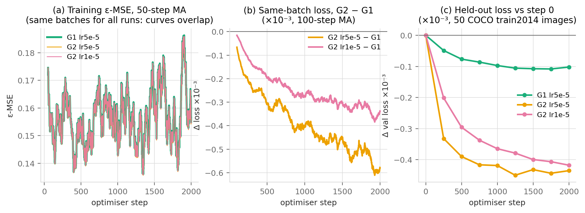
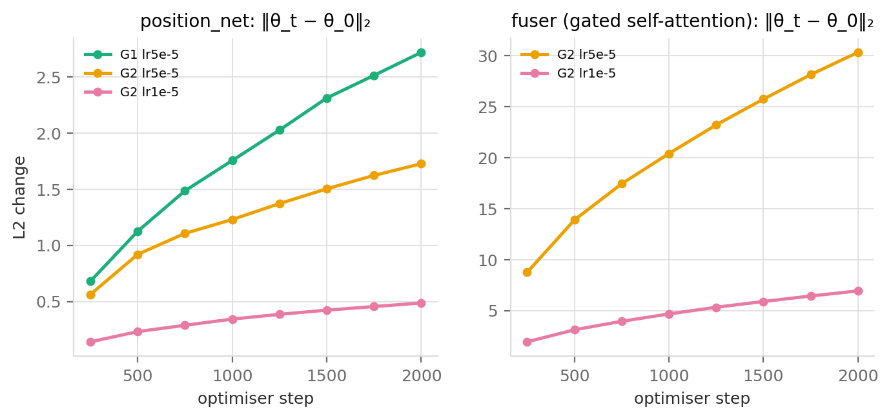
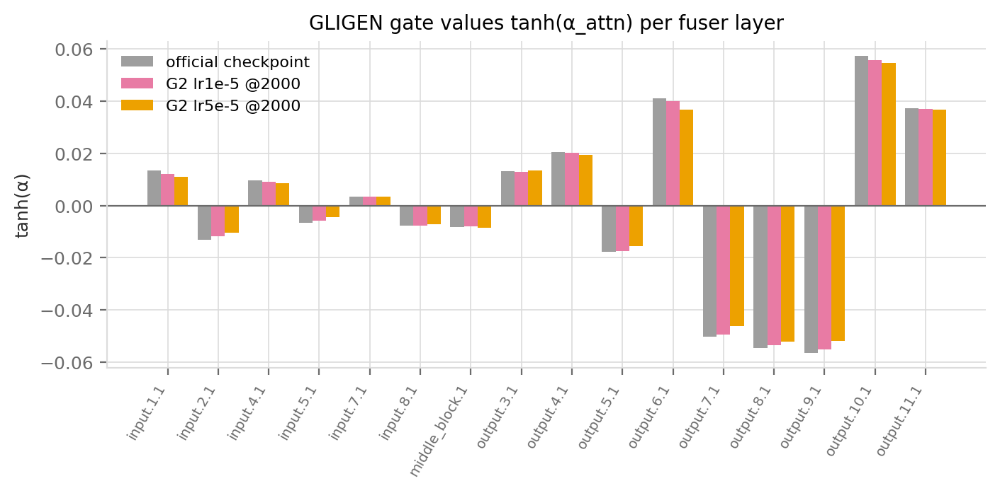
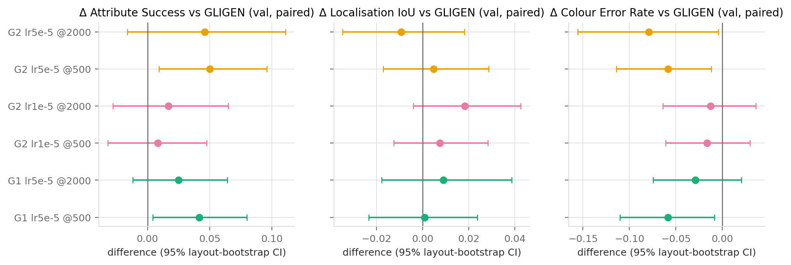

# GLIGEN 局部微调分析：学习率、检查点与 position_net 的作用（验证集）

数据来源：`outputs/runs/*`（集群 A40，三组各 2000 步）、`outputs/results/val_finetune/`（验证集 30 布局 × 2 种子，r = 0.5，
由集群作业 43571 产出）。表格和图由 `analysis/plot_training.py` 生成（`outputs/final_analysis/finetune_tables.md`、`figures/train_*.png`、`figures/finetune_*.png`）。
**所有结论只基于验证集，属于探索性结论；测试集上的微调评测（C-3 测试部分）尚未运行。**

## 1. 训练过程本身说明了什么

- **三组的训练损失曲线完全重合**（图 a）。留出损失用的是 `coco_trainval.jsonl` 中的 **50 张**图（`val_log.jsonl` 的 `n_images`），不是清单里的全部 100 张。这不是错误：三组用同一随机种子 2024，取样同一批图、同一噪声和同一时间步，
  而 ε-MSE 的逐批波动（0.13–0.19）比模型差异大两个数量级。因此比较要看**同批差值**（图 b）和**固定噪声的留出损失**（图 c）。
- 同批差值显示 G2（position_net + fuser）比 G1（仅 position_net）在同样的输入上损失更低，2000 步时约低 0.6×10⁻³（lr 5e-5）
  和 0.35×10⁻³（lr 1e-5）；留出损失的下降量也按 G2-5e-5 > G2-1e-5 > G1 排序，并且在 1250 步后基本饱和。
- **绝对变化非常小**：留出损失从 0.18174 降到 0.18130（−0.24%）。这是预期的：训练数据只有 COCO 类别短语、没有颜色监督，
  微调的只是 0.1%（G1）或 19.6%（G2）的参数，而且基座 SD1.4 的去噪能力没有改变。因此不应指望微调带来大幅提升。

- 权重漂移随步数近似线性增长（恒定学习率，无衰减），说明训练还没有收敛到"权重停止移动"的状态，也没有发散。
- 学习率 5e-5 与 1e-5 下 fuser 的漂移比约为 4.4:1（30.3 vs 6.9），position_net 约 3.5:1，与学习率比 5:1 同量级。
- 只训练 position_net 时它的漂移（2.72）大于同时训练 fuser 时（1.73）：当 fuser 可以一起调整时，部分修正由 fuser 承担。

- GLIGEN 每个 fuser 层有一个标量门 α，输出为 `x + tanh(α)·SelfAttn([x; objs])`。官方检查点里 **|tanh(α)| 全部 < 0.06**，
  上采样后半段（output_blocks 7–11）绝对值最大。2000 步微调后门值几乎不变（最大改变 0.004）。这不支持“通过明显增大 grounding 门”这一解释，
  但也不能排除小幅门值变化的作用，更不能据此断定变化来自 fuser 内部权重；需要单独的门值消融才能判断，变化也可能来自 position_net 或两者的相互作用。

## 2. 学习率与检查点（验证集）

| 配置 | Attribute Success | 相对官方 GLIGEN 的配对差值 [95% CI] | 颜色正确率（给定位置正确） | 定位 IoU |
|---|---:|---|---:|---:|
| GLIGEN 官方 (G0) | 0.279 | — | 0.310 | 0.746 |
| G1 lr 5e-5 @500 | 0.321 | **+0.042 [+0.004, +0.080]** | 0.363 | 0.747 |
| G1 lr 5e-5 @2000 | 0.304 | +0.025 [−0.012, +0.064] | 0.340 | 0.755 |
| G2 lr 1e-5 @500 | 0.287 | +0.008 [−0.032, +0.047] | 0.322 | 0.753 |
| G2 lr 1e-5 @2000 | 0.296 | +0.017 [−0.028, +0.065] | 0.327 | 0.764 |
| G2 lr 5e-5 @500 | 0.329 | **+0.050 [+0.009, +0.096]** | 0.369 | 0.751 |
| G2 lr 5e-5 @2000 | 0.325 | +0.046 [−0.016, +0.111] | 0.375 | 0.737 |

读法（按作业要求的"超参数分析"）：

1. **学习率**：G2 用 1e-5 时与官方模型没有可分辨的差别（两个检查点都 < +0.02，区间跨 0）；5e-5 的验证集点估计更高（约 +0.05）。
   但直接比较 G2 两种学习率（同检查点配对）：+0.042 [−0.004, +0.093]（500 步）、+0.029 [−0.016, +0.073]（2000 步），**区间都含 0**，
   所以现有数据只能说"1e-5 没有看到效果"，**不能证明 5e-5 优于 1e-5**。为 C-3 测试集选 G2 lr 5e-5 的依据只是验证集点估计更高、且与 G1 同学习率便于比较。
2. **检查点**：**没有发现 2000 步相对 500 步的一致优势**：G1 从 0.321 回落到 0.304，G2-5e-5 持平（0.329 → 0.325），G2-1e-5 略升；
   配对差值 2000−500 全部区间跨 0。留出损失在约 1250 步后饱和、权重漂移持续增长，但我们**没有在任务指标上评测 500–2000 之间的检查点**，
   因此不能断言"500–1000 步足够"，只能说没有证据支持训练到 2000 步。
3. **变化出现在哪里**：最大的正向点估计落在“颜色正确率（给定位置正确）”上（0.31 → 0.36–0.38）。定位与对象出现指标没有一致改善：
   Object Recall 的差值为 −0.013–0，定位 IoU 为 −0.009–+0.018；Position Success 多数在 ±0.02 内，但 G2-5e-5 @2000 为 −0.033。以上区间均跨 0，
   因而只能说验证集没有建立定位或对象出现率的提升；观察到的正向变化主要体现在 mask 内目标颜色更常通过阈值，
   颜色错误率从 0.62 降到 0.54–0.56，颜色串扰（Color Leakage Rate）在 G2-5e-5 下从 0.36 降到 0.30 [−0.103, −0.013]。
   注意训练数据没有任何颜色监督，所以这更可能是 grounding token 与文字提示的对齐被改善的副作用，而不是模型学会了颜色。

## 3. position_net 的作用（分工项"position_net 对位置控制和对象出现率的影响"）

- position_net 是 GLIGEN 唯一把框坐标变成 token 的模块：框坐标 (x0,y0,x1,y1) 的 Fourier 编码（64 维）与该短语的 CLIP 文本特征（768 维）
  拼接成 832 维，经三层 MLP（832→512→512→768，SiLU）输出 grounding token；每个布局固定 30 个槽位（空槽用可学习的 null 特征填充并带 mask），
  参数 1,083,968（UNet 的 0.10%；`outputs/analysis/gligen_probe.json`）。
- **只训练它（G1）在验证集上得到与 G2-5e-5 同量级的 Attribute Success 变化**（+0.042 vs +0.050，二者配对差 +0.008 [−0.029, +0.045]，不可区分），
  但花费只有 1/193 的可训练参数和更少的显存（5.8 vs 8.4 GB）。
- 对**位置控制**与**对象出现率**，G1 没有显示可分辨的改善：Object Recall 为 0.950/0.942（官方 0.950），Position Success 为 0.883/0.896（官方 0.900），
  定位 IoU 为 0.747/0.755（官方 0.746），所有配对区间均跨 0。因此现有验证集证据不能证明 position_net 改善了定位或对象出现率；也不能据此声称这些指标已达到检测器上限。
- 这个结论在测试集上的验证（G1 @ 测试集）要等 C-3 测试部分运行后补入；验证集只有 30 个布局，±0.04 的区间宽度意味着
  这里的所有正向差值都应读作"方向性证据"。

## 4. 对报告的建议措辞

- 用"验证集上的探索性结果"描述本节；明确写出 30 布局、未做多重比较校正；
- 超参分析的结论句：1e-5 下未见效果，5e-5 点估计更高但未证明更优；未发现 2000 步相对 500 步的一致优势；变化集中在颜色绑定而非定位；
- 如果 C-3 测试结果到位，用测试集数字替换表格并注明"测试集只评测了验证集选出的配置（G1 和 G2 lr 5e-5）"。
