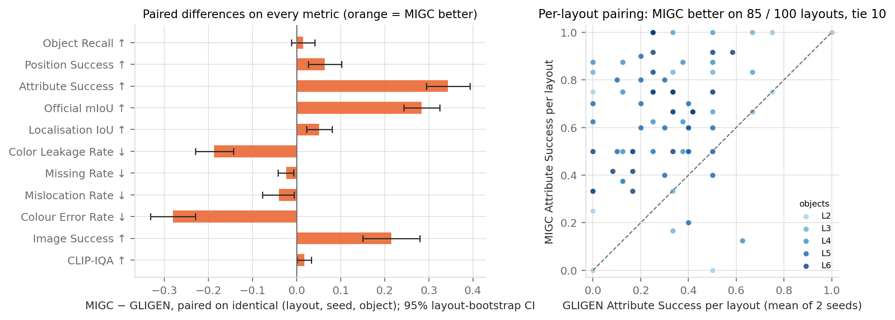
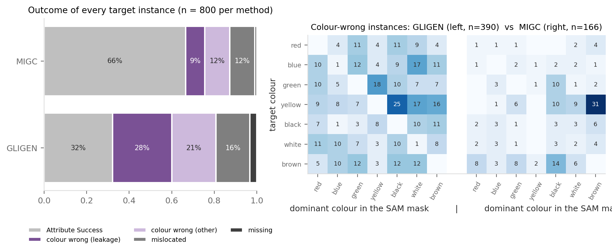
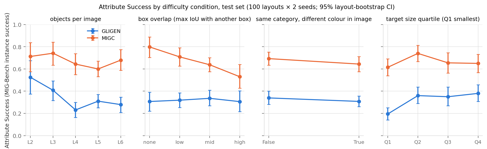
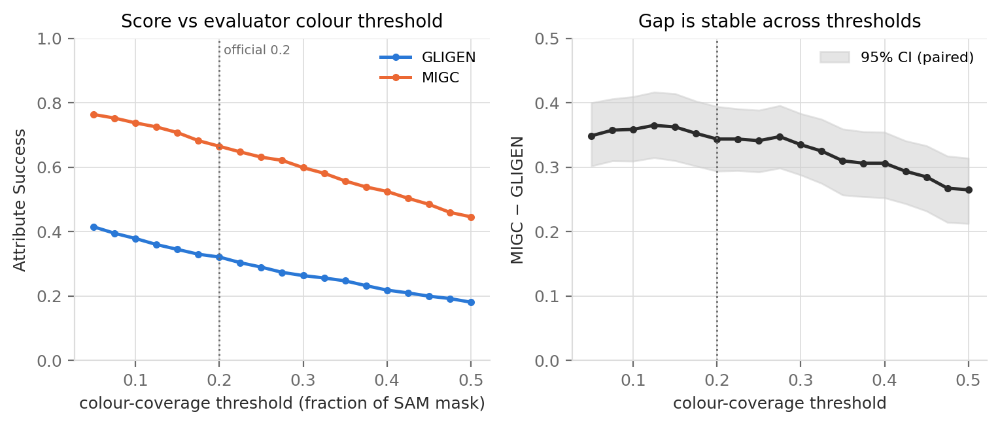
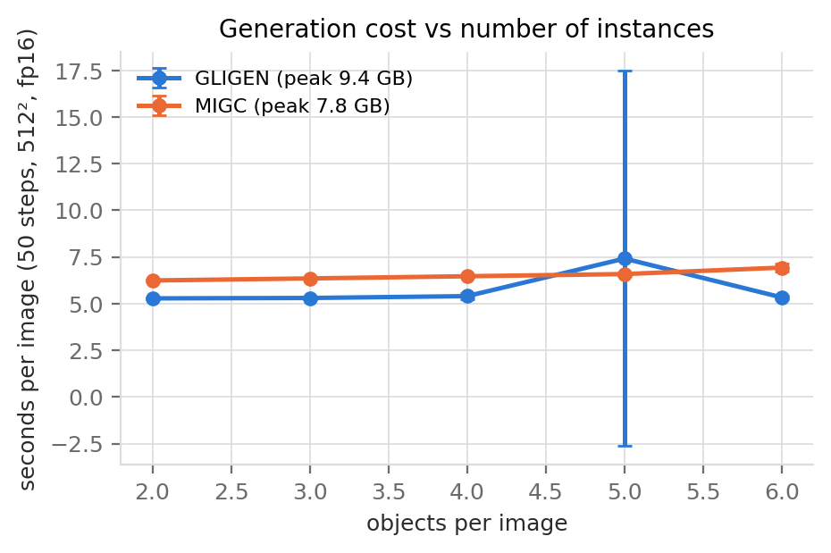

# 测试集结果与失败模式分析（GLIGEN vs MIGC）

> **数据状态：** 本文数字来自仓库当前提交的 `outputs/results/test_original/`；其生成元数据（Windows 本机路径特征，公开产物中已隐藏绝对路径；5.75 s/张）指向**本机 RTX 4070**，
> 不是 README §4.2 引用的集群运行。README 给出的集群数字（0.319 / 0.669）与这里的 0.321 / 0.665 接近，但集群文件不在仓库里，**这一比较目前无法核验**。集群结果提交进仓库后，重新运行
> `python analysis/make_figures.py && python analysis/failure_cases.py`，然后只需核对本文括号里的数字；结论的措辞已按"模式"而非具体数值组织。

图表：`outputs/final_analysis/figures/test_*.png`、`cases_*.png`；表：`results_table.md`、`subgroup_table.md`、`failure_cases/cases.csv`。
指标定义见 `docs/METRICS.md`。

## 1. 总体结果

| 指标 | GLIGEN | MIGC | MIGC − GLIGEN（配对，95% CI） |
|---|---:|---:|---|
| Object Recall | 0.917 | 0.932 | +0.015 [−0.012, +0.041]（不显著） |
| Position Success | 0.809 | 0.873 | +0.064 [+0.026, +0.102] |
| Localisation IoU | 0.690 | 0.741 | +0.051 [+0.023, +0.081] |
| **Attribute Success**（MIG-Bench 实例成功率） | 0.321 | 0.665 | **+0.344 [+0.296, +0.393]** |
| Attribute Success \| Position | 0.397 | 0.762 | +0.365 |
| Image Success | 0.065 | 0.280 | +0.215 [+0.150, +0.280] |
| Color Leakage Rate | 0.279 | 0.091 | −0.188 [−0.228, −0.144] |
| CLIP-IQA | 0.689 | 0.707 | +0.018 [+0.002, +0.034] |

读法：
1. **两种方法都能把物体画出来**（Object Recall 0.92 vs 0.93，差值区间跨 0），MIGC 把物体放得稍准一点（Position Success +0.06，IoU +0.05）。
2. **差距主要伴随颜色通过率的差异**：位置对了的实例里，GLIGEN 只有 40% 颜色正确，MIGC 有 76%；位置相关指标的差值都很小。
   注意这**不是因果分解**：颜色只在位置通过后才判定，不能把 +0.34 简单拆成"+0.06 定位 + 其余颜色"。
3. **整图成功率**对实例成功率是放大器：每图平均 4 个实例，GLIGEN 实例 0.32 → 整图 0.065，MIGC 0.665 → 0.28。
4. 图像质量（CLIP-IQA）差异很小（+0.018），说明 MIGC 的控制没有以画质为代价；两者 CLIP-IQA 区间大量重叠。
5. 按布局配对：100 个布局中 MIGC 在 85 个上更好、10 个打平、5 个更差；没有哪个对象数级别例外。

## 2. 失败模式

每个目标实例恰好落入四类之一（成功 / 颜色错 / 位置错 / 缺失）：

| | GLIGEN | MIGC |
|---|---:|---:|
| 成功 | 32% | 66% |
| 颜色错 — 其中串色（mask 主色是画面里另一个目标的颜色） | 49% — 28% | 21% — 9% |
| 位置错（有检测但 IoU < 0.5） | 16% | 12% |
| 缺失（无同类检测） | 3% | 1% |

- **GLIGEN 的颜色错误是弥散的**：热图左半边几乎每个（目标色，实际主色）组合都有样本，57% 的颜色错误是串色。
  典型案例（`cases_A.png`）：六个不同颜色的甜甜圈，GLIGEN 把它们画成了两三种颜色的随机分配；"a blue apple" 被旁边 "a red cup" 的红色覆盖。
  这与结构**相容**（但没有单组件消融来证明因果）：GLIGEN 的 grounding token 在同一个自注意力里互相可见，颜色最终又由含全部颜色词的 caption
  经冻结交叉注意力决定，没有机制把"红"绑定到某一个框（见 `architecture_analysis.md` §3）。
- **MIGC 的颜色错误是集中的**：166 个颜色错误里 31 个是 "yellow → brown"、14 个 "brown → black"、10 个 "yellow → black"，
  三对合计 55/166 = 33%（若再算上 10 个 "green → black" 则为 39%），落在 HSV 色表相邻、人眼也容易混淆的颜色对上。
  案例 `cases_E.png`：MIGC 画出的"yellow cow"是一头浅褐色（tan）的牛，评测判为 brown；"brown vase" 是明显的棕色花瓶，HSV 判为 red。
  **这部分应视为评测器的局限而不全是模型错误**；对 GLIGEN 同样的规则同样适用，所以不影响排序，但说明 MIGC 的"真实"属性成功率可能比 0.665 更高。
- **缺失和位置错在两者中都少**，MIGC 更少。GLIGEN 的位置错误里有一部分是"画出了对象但偏出框"（`cases_B.png` 中的餐桌、沙发），
  和它只在前 30% 步施加 grounding 的调度方式有关：后 70% 的普通去噪可以把物体"长"到框外。

## 3. 困难条件

| 条件 | GLIGEN 的变化 | MIGC 的变化 | 差距 |
|---|---|---|---|
| 对象数 L2 → L6 | 0.53 → 0.28，**随对象数下降**（L2 → L4 下降最快） | 0.71 → 0.68，基本平稳 | 从 +0.19 扩大到 +0.40 |
| 框重叠 none → high | ≈ 0.31 平稳 | **0.80 → 0.53 单调下降** | 从 +0.49 收窄到 +0.22 |
| 同类异色 | 0.34 → 0.31 | 0.69 → 0.64 | 几乎不变（+0.35 vs +0.34） |
| 目标大小 Q1（最小）→ Q4 | **0.20 → 0.38，小目标明显更差** | 0.62 → 0.65 | Q1 上差距最大（+0.42） |

解读：
1. **对象数**是 GLIGEN 的主要困难：实例越多，共享注意力里的颜色词越多，串色概率越高；MIGC 的实例分支数量随对象数增加但互不干扰，所以平稳。
   这是两种结构最直接的可观测区别。
2. **框重叠**是 MIGC 的主要困难——这**与**我们在架构分析里对 SAC 的预期**相反**。一种未经验证的解释：重叠区域里两个实例的
   masked cross-attention 都会给出自己的颜色，SAC 的 softmax 权重是**加权融合**而非硬选择，两者被稀释后其中之一在 mask 内达不到 0.2 的占比（`cases_D.png` 中重叠的卡车/汽车）。
   GLIGEN 在这一维度上平稳，可能是因为它在无重叠时就已接近下限（0.31）。要确认这一解释需要单独的消融（例如把 SAC 换成平均）。
3. **同类异色**对两者都几乎没有额外影响，说明颜色错误主要不是"同类之间混淆"，而是任意实例之间的串色。
4. **小目标**：COCO-MIG 没有 COCO 定义的 small 目标（最小边长 66 px），但最小四分位（归一化面积 < 0.051）仍然让 GLIGEN 掉到 0.20。
   MIGC 的 4 个控制层在 8²/16² 分辨率上，一个 Q1 目标（归一化面积 0.017–0.051）在 16² 上约占 4–13 个 token、8² 上 1–3 个，却没有明显变差；
   GLIGEN 在 64² 层也有 fuser，却更差。这提示控制"在哪一层"可能不如"怎样隔离"重要（解释性假设）。

## 4. 评测器可靠性：颜色阈值敏感性

- 把 MIG-Bench 的颜色覆盖率阈值从官方 0.2 在 0.05–0.5 间扫描（固定图像、检测和 SAM mask，`colour_threshold_curve.csv`）：
  两种方法的绝对分数随阈值近似线性下降（GLIGEN 0.42 → 0.18，MIGC 0.76 → 0.45），**差距在 0.26–0.37 之间，区间始终不含 0**。
- 结论：排序对阈值稳健，绝对值不稳健，报告分数时必须注明阈值 0.2；不能用更有利的阈值替代官方设置。
- 这份缓存不能用来改变位置阈值 0.5（位置不通过的目标没有颜色测量），也不能替换检测器/分割器；那需要重新跑 GPU 评测。

## 5. 计算成本

- GLIGEN 每张 5.7 s / 峰值 9.4 GB，MIGC 6.5 s / 7.8 GB（本机 RTX 4070，fp16，50 步）。集群 A40 上分别约 5.2 s / 5.7 s（README）。
- MIGC 的耗时随实例数增长（每个实例一支注意力），GLIGEN 基本恒定（固定 30 个槽位）；MIGC 显存更低是因为它只改 4 个低分辨率层。

## 6. 对报告"局限"一节的输入

1. 测试集 100 布局 × 2 种子；所有区间按布局 bootstrap；没有做多重比较校正。
2. 采样器未统一（PLMS vs Euler），差距中可能有小部分来自采样器。
3. 评测器：HSV 色表在 yellow/brown/black 之间的边界会把视觉上合理的结果判错，对 MIGC 影响更大。
4. 微调结果只有验证集（30 布局）；测试集上的微调评测尚未运行。
5. 两套测试结果（本机 / 集群）需在报告中只用一套并注明机器。
